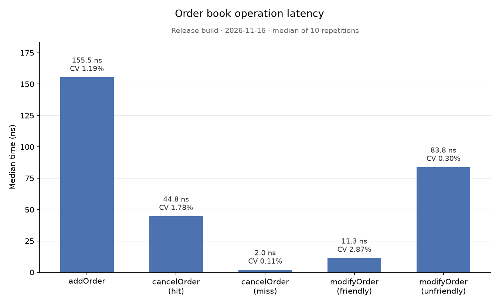
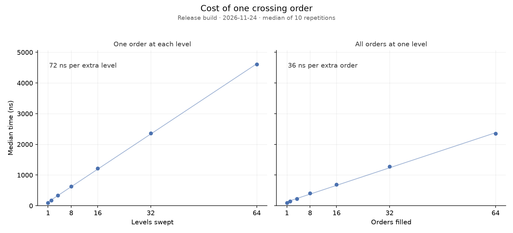
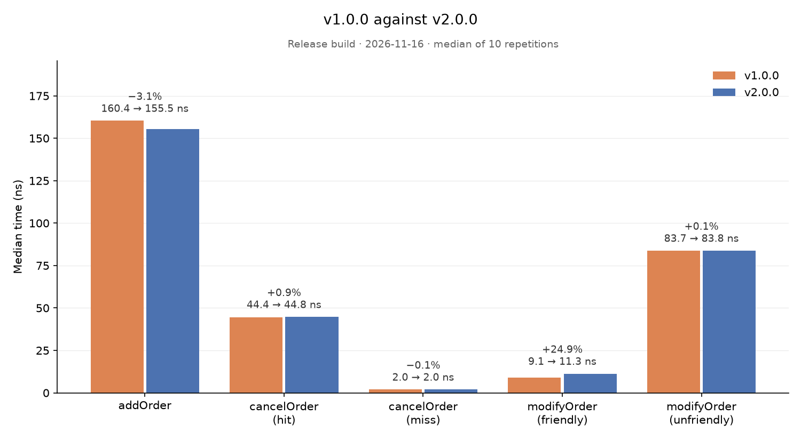
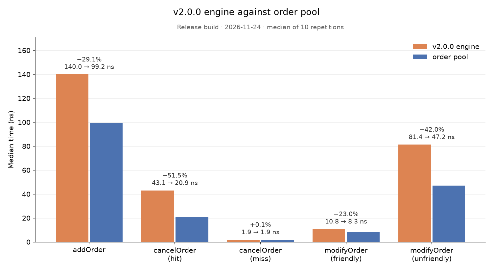

# OrderBook

[](https://github.com/wmarcos15/OrderBook/actions/workflows/ci.yml)

A price-time priority limit order book and matching engine in C++20, with a
GoogleTest suite (250+ tests) and a Google Benchmark suite that measures what
each operation actually costs — and a worked example of using those
measurements to decide what to change.

| Operation | v2.1.0 engine | With the order table | Change |
|---|---|---|---|
| `addOrder` (crossing two-sided flow, includes matching) | 105.1 ns | **73.2 ns** | −30% |
| `cancelOrder` — order exists, cancelled in ID order | 23.3 ns | **5.7 ns** | −75% |
| `cancelOrder` — order exists, cancelled in random order | 231.4 ns | **61.3 ns** | −74% |
| `cancelOrder` — order does not exist | 2.0 ns | **1.2 ns** | −40% |
| `modifyOrder` — quantity reduced in place | 8.6 ns | **6.7 ns** | −22% |
| `modifyOrder` — price changed (cancel + re-add) | 48.7 ns | **23.8 ns** | −51% |
| Crossing order — each extra price level swept | +74 ns | **+57 ns** | −23% |
| Crossing order — each extra resting order filled | +37 ns | **+20 ns** | −45% |

Single-threaded, Apple M2 Max, Release build. Both columns were measured back
to back on 2026-11-25, the first on the v2.1.0 engine, which finds orders
through a hash map, and the second on the engine with the order table, where
an order's ID says where its pointer is. **The current engine is newer than
these numbers**: the price levels have moved to a
[ladder](#core-data-structures) since, and it has not been benchmarked for
this page yet. That comparison, over every release, is
[issue #22](https://github.com/wmarcos15/OrderBook/issues/22). The step before this one, the
[order pool](#results-the-order-pool-and-intrusive-queues), had already taken
29% off `addOrder` and 52% off `cancelOrder`; it was measured on another day,
and only numbers from the same session compare. [Benchmarks](#benchmarks) has
the method, the matching-cost curves and a breakdown of where the time goes.



---

## Contents

- [What it does](#what-it-does)
- [Usage](#usage)
- [Design](#design)
- [Building](#building)
- [Benchmarks](#benchmarks)
- [Workload](#workload)
- [Project structure](#project-structure)
- [Future work](#future-work)

---

## What it does

- **Price-time priority matching.** Best price first; at equal price, the
  order that arrived first fills first. Trades execute at the resting order's
  price.
- **Order types:** `GTC` (rests until cancelled), `IOC` (fills what it can,
  discards the rest), `FOK` (fills completely or does nothing), and market
  orders.
- **Operations:** `addOrder`, `addMarketOrder`, `cancelOrder`, `modifyOrder`.
  Cancel and in-place quantity reduction are O(1), with no lookup by price
  except when a cancel empties its level.
- **Configurable price grid.** A `BookConfig` sets the tick size and the
  legal price band; prices off the tick or outside the band are rejected
  before anything in the book changes.
- **Owner IDs.** Every order carries the `OwnerID` of whoever placed it, and
  every trade records the owner on each side, so fills can be attributed to
  both the aggressor and the resting order.
- **Self-trade prevention.** An owner's incoming order never trades against
  that owner's own resting order. A policy decides what happens instead:
  `cancelNewest` drops the incoming order, `cancelOldest` cancels the resting
  one and keeps matching. The book has a default policy and each owner can
  override it.
- **O(1) depth queries** — `getLevelQuantity`, `getLevelCount` — from
  per-level aggregates maintained incrementally, never by walking a level.
- **Depth snapshot.** `getDepth` returns the top N levels of a side in one
  call, best level first, each with its price, total quantity and order
  count.
- **250+ unit tests**: book state (resting, level data, cancel, modify,
  argument validation, book configuration, owners, depth snapshot, copy and
  move), matching semantics (GTC partial/full fills and sweeps, time priority,
  trade contents and owners, IOC, FOK, market orders, self-trade prevention),
  random runs against a simple reference book, and the internal structures the
  book is built on: the order pool, the intrusive queue, the order table, the
  bitmap, the side index and the price ladder.
- **Benchmark suite** on Google Benchmark with a deterministic synthetic
  workload; results are committed alongside the script that plots them.

---

## Usage

The library is `orderbook_lib`; include `orderbook.hpp` and you get the whole
API. Everything it declares lives in `namespace orderbook`, so its `Order`,
`Trade`, `Price` and the rest cannot clash with types of the same name in
your own code. The examples below import the namespace to stay short. To
link the library from your own project, see
[Using it from another CMake project](#using-it-from-another-cmake-project).

```cpp
#include "orderbook.hpp"

using namespace orderbook;   // or qualify: orderbook::OrderBook, orderbook::Side, ...

OrderBook book;
constexpr OwnerID ALICE = 1, BOB = 2;

// Alice rests a sell at 10 001 for 50.
OrderResult ask = book.addOrder(ALICE, OrderType::GTC, Side::sell, 10'001, 50);

// Bob's buy at 10 002 for 80 crosses: 50 fill at the resting price (10 001),
// the remaining 30 rest at 10 002. The trade records Bob as bidOwner and
// Alice as askOwner.
OrderResult bid = book.addOrder(BOB, OrderType::GTC, Side::buy, 10'002, 80);
printTrades(bid.trades);   // [✓] MATCH | BUY #2 vs SELL #1 @ €10001 | 50 units traded

book.getLevelQuantity(Side::buy, 10'002);   // 30
book.getBestBid()->getRemainingQuantity();  // 30
book.getDepth(Side::buy, 5);                // { {10'002, 30, 1} }: price, quantity, order count

// Reducing quantity at the same price keeps the order's queue position
// and its ID. Any other change is a cancel + re-add and returns a new ID.
book.modifyOrder(bid.orderID, 10'002, 10);

book.cancelOrder(bid.orderID);
```

A book can also be created with a `BookConfig` that restricts which prices
are legal. Every field has a default (tick 1, band 1–100 000), so
`OrderBook book;` above uses those:

```cpp
// Prices must be multiples of 5 between 9 000 and 11 000 (edges included).
OrderBook book(BookConfig{.tickSize = 5, .minPrice = 9'000, .maxPrice = 11'000});

book.addOrder(BOB, OrderType::GTC, Side::buy, 10'005, 10);   // OK
book.addOrder(BOB, OrderType::GTC, Side::buy, 10'003, 10);   // throws: not on tick
book.addOrder(BOB, OrderType::GTC, Side::buy, 11'005, 10);   // throws: above maxPrice

book.getBookConfig().tickSize;   // 5
```

Self-trade prevention is on by default. The policy comes from
`BookConfig::defaultSelfTradePolicy` (`cancelNewest` unless set otherwise)
and can be overridden per owner:

```cpp
OrderBook book;

// Alice rests a sell, then sends a buy that would cross it.
OrderResult ask = book.addOrder(ALICE, OrderType::GTC, Side::sell, 10'001, 50);
OrderResult bid = book.addOrder(ALICE, OrderType::GTC, Side::buy, 10'001, 75);

bid.trades.empty();   // true: no trade against her own order
bid.status;           // OrderStatus::selfTradeCancelledNewest
// cancelNewest: the buy is dropped, the sell still rests with 50.

book.setSelfTradePolicy(ALICE, SelfTradePolicy::cancelOldest);
bid = book.addOrder(ALICE, OrderType::GTC, Side::buy, 10'001, 75);

bid.status;           // OrderStatus::selfTradeCancelledOldest
bid.cancelledOrders;  // { ask.orderID }: the resting sell was cancelled
// cancelOldest: matching carries on, and the 75 left over rest at 10 001.
```

The first example and the self-trade one are [`src/main.cpp`](src/main.cpp),
built as the `orderbook` target — run `./build/src/orderbook` to see them
execute.

Semantics worth knowing:

- `getDepth(side, levels)` returns the levels **best first**: bids from the
  highest price down, asks from the lowest price up, so element 0 is always
  the level `getBestBid()` / `getBestAsk()` sits on. Only prices that hold
  orders appear; an empty price between two levels is skipped, not reported
  with quantity 0. `levels` is a maximum: a side with fewer levels returns
  all it has, and an empty side or `levels == 0` returns an empty vector.
  Quantities are what is still resting, added over all owners. The result is
  a copy, so it does not change when the book does.
- The total quantity of a level is a 32-bit number, so `getLevelQuantity` and
  `getDepth` report a wrapped one for a level that holds more than
  4,294,967,295 units. Matching does not use it and is not affected.
- Owner IDs are chosen by the caller and passed as the first argument of
  `addOrder` / `addMarketOrder`; the book only stores them and copies them
  onto trades. A `modifyOrder` keeps the original owner, including when it
  becomes a new order with a new ID.
- Order IDs are assigned by the book (`1, 2, 3, …`) and returned in `OrderResult`.
  A `modifyOrder` that changes price or increases quantity loses time priority
  and returns a **new** ID; the old one is gone.
- `addOrder` / `modifyOrder` throw `std::invalid_argument` on zero quantity,
  or on a price below `minPrice`, above `maxPrice`, or not a multiple of
  `tickSize`. `addMarketOrder` throws on zero quantity too. A rejected
  `addOrder` or `addMarketOrder` consumes no ID; a rejected `modifyOrder`
  leaves the original order exactly as it was.
- An `OrderBook` cannot be copied, only moved. Its internal entries point
  into its own price levels, so a copy would share state with the original;
  copying is a compile error rather than a silent bug. Pass a book by
  reference, or `std::move` it. A book that has been moved from is empty, and
  `addOrder` and `addMarketOrder` on it throw `std::logic_error`.
- If memory runs out, the call throws `std::bad_alloc` and the book stays
  usable. What the call had already traded stays traded, and own orders it had
  cancelled as self-trades stay cancelled, but neither is reported. If it had
  done neither, nothing has changed except that an ID may have been used.
- The `OrderBook` constructor throws `std::invalid_argument` if the config is
  inconsistent: `tickSize` or `minPrice` not positive, `minPrice` above
  `maxPrice`, or either band edge not a multiple of `tickSize`. `modifyOrder` returns `std::nullopt` for an unknown ID.
  `cancelOrder` on an unknown ID is a silent no-op.
- A market order is converted internally to an `IOC` limit order at the edge
  of the price band, so it sweeps everything available and discards any
  residual. Against an empty opposite side it returns an ID and no trades.
- `FOK` is checked before touching the book, so a rejected FOK leaves the
  book untouched. It still consumes an order ID, which comes back in
  `OrderResult` alongside an empty trade list.
- A self-match is an incoming order meeting a resting order with the same
  `OwnerID`. It never produces a trade. Under `cancelNewest` matching stops
  there and whatever is left of the incoming order is dropped, even for a
  `GTC`. Under `cancelOldest` the resting order is cancelled and matching
  continues, so a `GTC` remainder rests as usual. Fills made before the
  self-match are kept under both policies. Own orders are never skipped over:
  that would trade through a better price.
- `OrderResult::status` says what prevention did to the caller's order.
  `selfTradeCancelledNewest` means the incoming order was stopped at an own
  order and dropped, so it is not in the book. `selfTradeCancelledOldest`
  means own resting orders were cancelled and the incoming order carried on
  as normal. `ok` means prevention did not fire. One call can only report
  one of them, because a self-match has a single owner and so a single
  policy. `OrderResult::cancelledOrders` lists the resting orders the book
  cancelled, in the order it reached them; it is only non-empty under
  `cancelOldest`.
- The policy is read when the self-match happens, not when an order was
  placed. Changing an owner's policy therefore also applies to that owner's
  orders already resting in the book.
- A `modifyOrder` that changes price or increases quantity is a new order, so
  it is the newest one. Under `cancelNewest`, a modify that crosses the
  owner's own opposite order cancels the original and drops the replacement:
  the result says `selfTradeCancelledNewest` and the order is gone from the
  book.
- The `FOK` check follows the owner's policy, so it predicts what matching
  will do. Under `cancelOldest` the owner's own resting orders do not count
  as liquidity. Under `cancelNewest` only the liquidity ahead of the owner's
  first own order counts. A rejected `FOK` cancels nothing under either
  policy. It reports `selfTradeCancelledNewest` when the check stopped at an
  own order, and `ok` when the book simply did not hold enough.

---

## Design

### Core data structures

```cpp
detail::Pool<detail::OrderNode> pool_;    // every resting order lives in here

detail::Ladder                  ladder_;  // one Level per legal price
detail::OrderTable<>            orders_;  // ID -> OrderNode*

struct Level {                // everything about one price, 24 bytes
    OrderQueue queue;         // { head, tail }
    LevelData  data;          // { qty, count }
};

struct OrderNode {            // one pool slot, 64 bytes: one cache line
    Order       order;
    OrderNode*  prev;         // neighbours in the level's queue
    OrderNode*  next;
    OrderQueue* level;        // the queue this node is in
    LevelData*  levelData;    // that level's aggregates
};
```

**The price ladder.** `BookConfig` fixes the legal prices, so the ladder is an
array with one `Level` for each of them, and `(price - minPrice) / tickSize` is
its position. Nothing is searched, and a price that starts or stops being used
allocates and frees nothing. Both sides share the array, since a price never
holds buys and sells at once: they would have traded. Each level is a FIFO
queue, so time priority is queue order, and its totals are updated on every
add, fill, cancel and modify, which is what makes the level queries O(1).

Each side has a bitmap that says at which positions it has orders, and
remembers its best one. When the best level empties, the next one is the next
bit that is on, found 64 positions at a time. A second, smaller bitmap says
which 64-bit words are not zero, so a long gap is jumped instead of walked.
Both bitmaps are updated only when a level gets its first order or loses its
last one.

**The pool.** A resting order is one `OrderNode` in a `Pool`. The pool asks
the system for memory in chunks of 4096 slots, rarely, and hands the slots out
itself: free slots form a chain, with the link stored inside the free slot
(the slot is a union of a live node and a link), so taking a slot is popping
the head of the chain and returning one is pushing it back, with no `malloc`
or `free` in between. Chunks never move, so the address of an order is stable
for as long as it rests, which is also what lets `getBestBid` and `getOrder`
return plain pointers. The pool never gives memory back until the book is
destroyed. It is not copyable, so the book is not either, and its move is
written by hand so that a moved-from pool does not share slots with the new
one.

**The queues.** The nodes carry their own `prev` and `next`, so a level's
queue is only a `head` and a `tail` pointer: it allocates nothing and owns
nothing, it threads through nodes that live in the pool. Pushing at the back,
popping the front and unlinking from the middle are a few pointer writes
each.

**The order table.** `orders_` maps an ID to its node. The book hands out IDs
in sequence, so there is nothing to hash: the table is a list of pages of 4096
pointers, `id / 4096` says which page and `id % 4096` which slot in it. Both
compile to one shift and one mask. An order that is gone leaves a null in its
slot, and since an ID is never used twice, looking it up finds nothing from
then on. What is reused is the memory: every page has a count of its live
orders, and when it reaches zero the page goes to a pile of spare ones,
already all null, for a later range of IDs to take. Adding an order therefore allocates nothing for
its lookup, except for a new page when the pile is empty.

The array of levels never grows, so a level never moves in memory and the
node's `level` and `levelData` pointers stay valid. The result is that
`cancelOrder` looks nothing up by price unless the level empties: it goes from
the ID to the node, unlinks it through its own neighbours, and gives the slot
back.

**Lifetimes are managed by hand.** The book owns an order from the moment it
rests until it is filled or cancelled, and ownership is never shared, so
nothing counts references. The price of that is a rule: every order that
leaves the book is released exactly once, last, and nothing reads it
afterwards. A stale pointer into a pool is not memory the system considers
freed, so the usual sanitizers would not notice it. Under AddressSanitizer
the pool therefore poisons every free slot, and reading one aborts with a
use-after-poison report; the CI sanitizer job runs the whole test suite that
way.

### Matching

`match()` loops while the incoming order has remaining quantity and the
opposite side's best level is at or through its limit price. Each iteration
fills against the front of the best level, records a `Trade{bidID, askID,
price, quantity, bidOwner, askOwner}` at the resting price, and pops the resting order if it is
now filled. An emptied level leaves its side's bitmap immediately, so the best
position always has orders. The best level is compared with the limit by
position, without turning either into a price.

Before filling, each iteration compares the two owners. That one integer
comparison is all a normal match pays for self-trade prevention; the policy
lookup only happens on an actual self-match. `cancelNewest` ends the loop,
and `cancelOldest` removes the resting order, without looking it up again,
and lets the loop ask for the best level again.

### Complexity

*W* is the number of 64-bit words in a side's summary bitmap: 25 for the
default band of 100,000 prices. It only matters when a level empties and the
next one is far away, and *W* depends on the width of the band, not on the
number of orders.

| Operation | Complexity | Notes |
|---|---|---|
| `addOrder` | O(1) + matching | the position is computed from the price; each match iteration is O(1) |
| `cancelOrder` | O(1) | table lookup, unlink through the node's own links, totals update via stored pointer |
| A level becomes empty | O(W) at worst | finding the next best level; O(1) if it is in the same word |
| `modifyOrder` (qty down) | O(1) | table lookup, `fill()`, totals update via stored pointer |
| `modifyOrder` (otherwise) | cancel + add | |
| `canFullyFill` (FOK check) | O(orders in price range) | walks single orders, because what counts depends on who owns each one |
| `getLevelQuantity` / `getLevelCount` | O(1) | position from the price, after checking that the side has orders there |
| `getDepth` | O(levels returned) | walks the side's bitmap from the best position and reads each level's totals; never walks the orders. A long gap costs up to O(W) |
| `getBestBid` / `getBestAsk` | O(1) | the stored best position |
| `getOrder` | O(1) | table lookup |

### Trade-offs

**An array of levels, not a sorted map.** A `std::map` costs a search for every
price and an allocation for every new one, and its cost does not depend on how
wide the band is. The array costs a calculation, but it has a `Level` for every
legal price whether it is used or not: 24 bytes each, about 2.4 MB for the
default band and 24 MB for a million prices, taken when the book is created.
There is no limit on the band, so a very wide one can take gigabytes. The band
also has to be known in advance, and prices outside it are rejected.

**An intrusive queue within a level.** The requirement is FIFO with O(1)
removal from the middle — a cancel must not walk the level. A doubly linked
list gives exactly that, and linking the nodes through the orders themselves
means it costs no allocation. A `std::vector` would traverse faster but make
mid-level removal O(n). The cost is that the list is written by hand and
trusts its caller: unlinking a node that is not in the queue silently
corrupts it. A node's links are cleared when it leaves a queue and checked
by `assert` when it joins one, and the queue has its own tests, but the book
is what keeps the rule.

**A pool and raw pointers, not `std::shared_ptr<Order>`.** Each order used to
be referenced from its level list and from `orders_`, which looked like shared
ownership but was not: the book owned the order from the moment it rested
until it was filled or cancelled. Plain pointers into a pool say that
directly and remove the atomic reference counting from the hot path. The
price is the lifetime rule described above, which is why the pool poisons its
free slots under AddressSanitizer. The pool grows in chunks and never
shrinks, so after a peak it keeps its slots until the book is destroyed. A
fixed capacity, as many production engines use, would remove even the
chunk allocations, but it would give `addOrder` a way to fail ("book full")
that the API does not have.

**A paged table, not a hash map or one flat array.** A hash map works for any
key, and pays for it on every operation: a hash, a search through a bucket and
a node allocated per order. Sequential IDs need none of that. One flat array
indexed by ID would be simpler still, but it keeps 8 bytes for every order
ever placed, and growing it copies everything. Pages keep the direct lookup
and give their memory back for reuse once every order in them is gone. The
price is that one old order keeps its whole page, 32 KB, in use. The list of
pages itself only grows, by 16 bytes for every 4096 IDs, which is about 4 MB
after a billion orders. And like the pool, the table keeps the pages it has
until the book is destroyed.

**One cache line per order.** An `OrderNode` is the 32-byte order, two links
and two level pointers: 64 bytes. The `orders_` entry is one pointer. Keeping
the two level pointers in the node and not in that entry costs nothing at
cancel time, which reads the node anyway.

**Allocations per resting order.** None, normally: the order and its place in
the queue come from the pool, and its lookup entry from the order table, which
both allocate only when they need another chunk or page. A new price level
allocates nothing either. An order that trades still allocates the `trades`
vector in its `OrderResult`.

---

## Building

Requires CMake ≥ 3.25 and a C++20 compiler. GoogleTest (v1.14.0) and Google
Benchmark (v1.8.3) are fetched automatically with `FetchContent` on first
configure. They are only fetched when building this repository itself, not
when it is used as a dependency.

```bash
cmake -DCMAKE_BUILD_TYPE=Release -S . -B build
cmake --build build --parallel
```

### Tests

```bash
ctest --test-dir build --output-on-failure
# or directly, for GoogleTest's own output / filters:
./build/tests/orderbook_tests
```

### Running the benchmarks

```bash
./build/benchmarks/orderbook_benchmark
```

Benchmarks only mean something in a **Release** build. A debug build disables
inlining and optimisation and produces numbers unrelated to real behaviour.

To regenerate the charts from a fresh run:

```bash
./build/benchmarks/orderbook_benchmark --benchmark_format=json > benchmarks/results_v2-table.json

cd benchmarks
python3 -m venv .venv && source .venv/bin/activate   # first time only
pip install -r requirements.txt
python3 plot.py results_v2-table.json                 # writes benchmark_plot.png and matching_curves_plot.png
```

`plot.py` takes the results file and the two output paths as optional
positional arguments; without any, it reads `results.json`. The curves are
only drawn when the results contain the sweep benchmark.

To compare two runs, `compare.py` draws them side by side with the change
for each operation:

```bash
python3 compare.py results_v1-rerun.json results_v2-map.json comparison_v1_v2_plot.png \
    --before-label "v1.0.0" --after-label "v2.0.0"
```

### Using it from another CMake project

Pull the repository in with `FetchContent` (or `add_subdirectory` on a local
copy) and link `orderbook_lib`:

```cmake
include(FetchContent)

FetchContent_Declare(
    orderbook
    GIT_REPOSITORY https://github.com/wmarcos15/OrderBook.git
    GIT_TAG v2.2.1
)

FetchContent_MakeAvailable(orderbook)

target_link_libraries(my_target PRIVATE orderbook_lib)
```

That gives `my_target` the include path for `orderbook.hpp` and compiles it
as C++20, which the library requires. Nothing else comes along: the tests,
the benchmarks, the example executable and the GoogleTest / Google Benchmark
downloads are only set up when OrderBook is the top-level project, so they
do not appear in your build or in your `ctest` run.

---

## Benchmarks

### What is measured

Each scenario is a Google Benchmark function with 10 repetitions; the
reported figure is the **median** across repetitions, with mean, standard
deviation and coefficient of variation (CV) alongside. Google Benchmark
chooses the iteration count itself unless the scenario pins it.

| Scenario | Setup | Measured loop |
|---|---|---|
| `BM_AddOrder` | Empty book | Replays a 1 M-order two-sided [workload](#workload) in order; wraps around when exhausted. Orders cross, so the cost **includes matching**. |
| `BM_CancelOrderHit` | ~1.9 M GTC buys across 21 price levels (the 2 M-order workload with market orders skipped) | Cancels IDs `1, 2, 3, …` in sequence. 100 k iterations pinned, so the pool is never exhausted. |
| `BM_CancelOrderShuffled` | Same | Cancels the same orders' IDs in a random order, from a fixed seed, so each cancel lands somewhere else in memory. 100 k iterations pinned. |
| `BM_CancelOrderMiss` | Empty book | Cancels IDs that were never issued — a single failed lookup. |
| `BM_ModifyOrder_Friendly` | 2 M GTC buys, all at one price, qty 100 | Reduces each order to qty 50 at the same price. 100 k iterations pinned. |
| `BM_ModifyOrder_Unfriendly` | Same | Moves each order one tick down at the same qty — internally cancel + add. 100 k iterations pinned. |
| `BM_MatchOrder_Sweep` | 128 k resting asks in a ladder of consecutive prices, the same number at every level | One buy that sweeps exactly the next *n* levels and fills every order in them. 13 points: 1 to 64 levels holding one order each, and 1 to 64 orders at a single level. Iterations pinned so that each repetition uses up the ladder exactly. |

The cancel and modify scenarios deliberately use a **single-sided book**. If
orders could match during setup, some targets would already be filled and the
benchmark would silently measure the miss path. One side guarantees every
target is resting.

Because of that, the unfriendly `modifyOrder` figure excludes fill cost: the
internal `addOrder` finds no contra side and its match attempt returns at
once. What is measured is the cost of moving an order within the book. A
reprice that crosses the spread costs more, and how much more depends on the
book state at that moment — a property of the market, not of the engine.

### Matching cost

There is no single "matching cost" number, because it depends on what the
order crosses: sweeping one level with one resting order and sweeping eight
levels with fifty orders each are both realistic, and differ by an order of
magnitude. The meaningful measurement is a curve — cost as a function of how
much is swept — and `BM_MatchOrder_Sweep` measures two of them.

The naive version of this benchmark is not worth reporting. Liquidity is
consumed as it is matched, so a loop either exhausts the contra side and
silently degrades into the non-matching case, or replenishes it inside the
timed region and pays timer-pause overhead comparable to the operation
itself. This one never refills. The setup builds a single ladder of asks at
consecutive prices, each iteration sends one buy that sweeps exactly the next
*n* levels and fills every order in them, and the iteration count is pinned
so that the ladder is used up exactly when the repetition ends. The timed
region is one `addOrder` call and nothing else, and the benchmark reports an
error if the book is not empty afterwards.



| Levels swept, one order each | Median | Orders filled, one level | Median |
|---|---|---|---|
| 1 | 81.1 ns | 1 | 81.1 ns |
| 2 | 150.3 ns | 2 | 117.3 ns |
| 4 | 267.7 ns | 4 | 168.8 ns |
| 8 | 511.7 ns | 8 | 266.0 ns |
| 16 | 971.8 ns | 16 | 440.6 ns |
| 32 | 1 873.9 ns | 32 | 754.2 ns |
| 64 | 3 670.0 ns | 64 | 1 366.2 ns |

These are the curves of the engine with the order table, before the price
ladder. Both are close to straight lines: about **57 ns for each extra level** and **20 ns for each
extra order**. Sweeping a level that holds one order means filling that order
and then removing the level, so the difference between the two slopes, roughly
37 ns, is the price of removing a level: one node erased from the `std::map`
and one from the level-totals hash map. The 20 ns per order covers unlinking
the node, clearing its slot in the order table, returning the node to the pool
and appending a trade. On the v2.1.0 engine, run the same day, the slopes were
74 and 37 ns: the table made each order cheaper and left the price of removing
a level where it was, as the pool had done before it.

Two limits of the method. A ladder of 128 000 price levels is not a
realistic book; it is that long only so that it never runs out. And every
order is allocated one after another from a fresh pool, so neighbours in the
book are neighbours in memory, which a long-lived book would not enjoy. Both
flatter the absolute numbers. Neither affects a comparison between two
engines run through the same benchmark, which is what the curves are for.

### Environment

All runs were made on the same machine with the same build configuration.
The two September runs were made the same day, and each pair of November runs
within two minutes of each other.

| Field | Value |
|---|---|
| Build type | Release |
| Compiler | Apple clang 21 |
| OS | macOS |
| CPU | Apple M2 Max, 12 cores |
| CPU scaling | disabled (as reported by Google Benchmark) |
| L1 data / instruction | 64 KiB / 128 KiB |
| L2 unified | 4 MiB |
| Workload seed | 42 |
| Repetitions | 10 |
| Baseline run | 2026-09-06 18:10, load avg 1.68, code at `4b4fa81` — [`results_4b4fa81.json`](benchmarks/results_4b4fa81.json) |
| O(1)-cancel run | 2026-09-06 19:43, load avg 1.72, code at `v1.0.0` — [`results.json`](benchmarks/results.json) |
| v2.0.0 baseline run | 2026-11-16 01:25, load avg 3.73, code at `v2.0.0` plus the sweep scenario — [`results_v2-map.json`](benchmarks/results_v2-map.json) |
| v1.0.0 re-run | 2026-11-16 01:27, load avg 3.20, code at `v1.0.0` — [`results_v1-rerun.json`](benchmarks/results_v1-rerun.json) |
| v2.0.0 engine, for the pool comparison | 2026-11-24 12:27, load avg 3.13, code at `dcde386` — [`results_v2-map-rerun.json`](benchmarks/results_v2-map-rerun.json) |
| Pool run | 2026-11-24 12:28, load avg 2.50, code at `aafcef5` — [`results_v2-pool.json`](benchmarks/results_v2-pool.json) |
| v2.1.0 engine, for the table comparison | 2026-11-25 04:41, load avg 2.51, code at `e8c4ff9` — [`results_v2-pool-rerun.json`](benchmarks/results_v2-pool-rerun.json) |
| Table run | 2026-11-25 04:41, load avg 2.33, code at `1ad5f28` — [`results_v2-table.json`](benchmarks/results_v2-table.json) |

Google Benchmark prints two warnings on this platform, neither of which
affects the timings. It cannot read `hw.cpufrequency` on Apple Silicon (cores
scale dynamically and P/E cores run at different clocks), so the reported CPU
frequency is meaningless metadata. And it cannot set thread affinity on macOS,
so the process is not pinned to a core; the CV column below quantifies how
much stability that cost.

### Results: v2.0.0 baseline

| Operation | Median | Mean | Std dev | CV |
|---|---|---|---|---|
| `addOrder` | 155.5 ns | 155.4 ns | 1.85 ns | 1.19% |
| `cancelOrder` (hit) | 44.8 ns | 44.6 ns | 0.79 ns | 1.78% |
| `cancelOrder` (miss) | 1.98 ns | 1.98 ns | 0.002 ns | 0.11% |
| `modifyOrder` (friendly) | 11.3 ns | 11.4 ns | 0.33 ns | 2.87% |
| `modifyOrder` (unfriendly) | 83.8 ns | 83.9 ns | 0.25 ns | 0.30% |

A second full run made immediately afterwards agreed within 1% on every
scenario except the friendly modify, which moved by 0.4 ns.

**These figures are about 28% lower than the September ones further down,
and that is not the code.** The clearest evidence is the `cancelOrder` miss:
a single failed hash lookup, unchanged since the first version, went from
2.79 ns to 1.98 ns. Something about the machine changed in the two months
between the runs — operating system, toolchain or power state; the runs do
not say which. To separate the machine from the code, the v1.0.0 code was
rebuilt and run two minutes after the baseline:

| Operation | v1.0.0, re-run | v2.0.0 | Difference |
|---|---|---|---|
| `addOrder` | 160.4 ns | 155.5 ns | −3.1% |
| `cancelOrder` (hit) | 44.4 ns | 44.8 ns | +0.9% |
| `cancelOrder` (miss) | 1.98 ns | 1.98 ns | −0.1% |
| `modifyOrder` (friendly) | 9.07 ns | 11.3 ns | +24.9% |
| `modifyOrder` (unfriendly) | 83.7 ns | 83.8 ns | +0.1% |



So everything v2.0.0 added — owner IDs, the self-trade check on every match,
price validation against the tick and the band, the policy-aware `FOK` check
— costs nothing measurable on `addOrder`, `cancelOrder` or a repricing
modify. The `addOrder` difference is small enough to be drift, and the two
versions do not do identical work there: about 1% of v2.0.0's matches are
self-trades and are prevented. The one real cost is on the friendly modify,
2.2 ns on an operation that took 9. The likely cause is `validatePrice`,
which now runs on that path and contains an integer remainder
(`price % tickSize`).

The broader point is the one this project keeps making: the same code
measured 216 ns in September and 160 ns in November. Absolute numbers from
different days are not comparable, and every comparison from here on is made
back to back.

### Where the time goes

The benchmarks say how long each operation takes; a profile says what it
spends that time on. This is the profile of the v2.0.0 engine, the one the
rewrite started from. Each operation was run in a loop for five seconds
against the same Release library while macOS's `sample` recorded its call
stack every millisecond. Only the samples inside the operation itself are
counted, so the setup that builds the book is left out.

| Operation | Allocating and freeing memory | `orders_` hash map | Level-totals hash map | Everything else |
|---|---|---|---|---|
| `addOrder` (the mixed workload) | 35% | 28% | 7% | 30% |
| `cancelOrder` (hit) | 70% | 15% | — | 15% |
| Sweep, 64 levels of one order | 54% | 5% | 8% | 33% |
| Sweep, one level of 64 orders | 54% | 9% | 8% | 29% |

The hash map columns are lookups, inserts and erases, not counting the
memory for their nodes, which is in the first column. "Everything else" is
the `std::map` of price levels, the level lists, `shared_ptr` reference
counting and the book's own logic; the compiler inlines those into each
other, so a sampling profiler cannot separate them. The part of `std::map`
that does stay visible is 2% of `addOrder` and 7% of the 64-level sweep.

**Allocation is the largest cost of every operation.** A `cancelOrder` is
three frees and little else: the `Order`, its list node and its `orders_`
node, in roughly equal parts. In `addOrder` about a third of the allocation
time is the `Order` itself, about a fifth is the `orders_` node, and about a
fifth is something that is on no list of optimisations: the `trades` vector
inside `OrderResult`, allocated for every order that trades and regrown as
it fills.

**The `orders_` hash map is the second largest**, at 28% of `addOrder`
before its node allocations are counted. The table holds every live order,
so it is the one structure that does not stay in cache.

**The price map is small.** The structure a price ladder would replace —
the `std::map` and the level-totals hash map together — is around a tenth of
`addOrder`. It matters more when an order sweeps many levels, where removing
a level is 38 of the 101 ns each level costs. This is what the September
discussion at the end of this section predicted: the change that sounds most
significant is the one that matters least for the common path.

Limits: the table gives the middle of several runs, and the runs do not
agree to the digit. The allocation share came out between 33% and 36% for
`addOrder`, between 52% and 56% for the sweeps, and between 64% and 76% for
`cancelOrder`, whose measured loop is short and collects the fewest samples.
The ranking of the columns was the same in every run. And which allocation
belongs to which structure was read from a second build with inlining
disabled, which distorts timings and was used for nothing else.

The profile can be repeated with the tools in
[`benchmarks/profile/`](benchmarks/profile): `orderbook_profile` runs one
operation in a loop, without the setup-heavy benchmark harness around it,
and `breakdown.py` attaches `sample` to it and adds up the result. They need
macOS.

```bash
cmake --build build --target orderbook_profile
python3 benchmarks/profile/breakdown.py            # all four operations
python3 benchmarks/profile/breakdown.py cancel --seconds 10
```

### Results: the order pool and intrusive queues

The first engine change that the profile above asked for: orders are taken
from a pool and linked into their level's queue through their own `prev` and
`next`, instead of a `std::make_shared` per order and a `std::list` node per
resting order. Nothing about the API or the behaviour changed, and no
existing test was edited.

The previous code (`main` at the v2.0.0 baseline) was built next to the new
code and the full suite was run on each, back to back, with the baseline run
a second time after the new one to see the drift. The second baseline run
agreed with the first within 2.2% on every scenario.

| Operation | v2.0.0 engine | With the pool | Change | CV (pool) |
|---|---|---|---|---|
| `addOrder` | 140.0 ns | **99.2 ns** | −29.1% | 1.20% |
| `cancelOrder` (hit) | 43.1 ns | **20.9 ns** | −51.5% | 2.02% |
| `cancelOrder` (miss) | 1.92 ns | **1.92 ns** | +0.1% | 0.10% |
| `modifyOrder` (friendly) | 10.8 ns | **8.3 ns** | −23.0% | 0.97% |
| `modifyOrder` (unfriendly) | 81.4 ns | **47.2 ns** | −42.0% | 1.89% |
| Each extra level swept | +97.3 ns | **+71.5 ns** | −26.5% | |
| Each extra order filled | +60.6 ns | **+35.7 ns** | −41.1% | |



The `cancelOrder` miss is the control: it never touches an order, and it did
not move. Everything else got faster, in proportion to how many allocations
it used to make. A cancel went from three frees to one, and takes half the
time; the extra cost of an order filled in a sweep fell by 41%, which is the
`Order` and its list node no longer being freed one by one.

**The profile agrees.** The same breakdown as above, run on both versions
for ten seconds each:

| Operation | Allocating and freeing | `orders_` hash map, with its nodes |
|---|---|---|
| `addOrder` | 32.9% → 28.0% | 36.1% → 40.2% |
| `cancelOrder` (hit) | 69.8% → 49.8% | 58.9% → 68.3% |
| Sweep, 64 levels of one order | 53.0% → 45.5% | 14.6% → 19.7% |
| Sweep, one level of 64 orders | 52.5% → 37.4% | 24.1% → 38.4% |

These are shares of a shorter operation, so a share can stay put while the
time it stands for shrinks: the allocation in `addOrder` is about 46 ns
before and about 28 ns after, and in `cancelOrder` about 30 ns before and
about 10 ns after. The allocation that left is the one this change targeted.
In the old `cancelOrder` the list node was freed in the book's own logic (26%
of the operation, now 3%), while the `Order` was freed inside the `orders_`
erase, which dropped the last reference to it. So the `orders_` column before
the change includes freeing the `Order`. In `addOrder`, allocation in the
book's own logic fell from 23% to 13%, and the `trades` vector is part of
what remains. The `orders_` hash map is now the largest single structure in
both: 40% of `addOrder` and 68% of `cancelOrder`, its node allocations
included. That is the next step.

Two limits. The profile shares are good to a few points, and one run of
`cancelOrder`, whose loop is short, can move by more. And the new book's
orders come from fresh, contiguous pool slots in these benchmarks, as the
old ones came from a fresh heap, which flatters both versions' memory
locality compared with a book that has been running for hours. The profile
script had to learn the new types to compare the two fairly: it recognised
the `orders_` map by the name of its old value type, so on the first run of
the new code that work was counted as "book logic".

### Results: the paged order table

The second engine change, and the step the pool's profile pointed to: the
`orders_` hash map is replaced by the paged table described under
[Design](#core-data-structures). Nothing about the API or the behaviour
changed, and no existing test was edited.

The v2.1.0 engine and the new one were built next to each other and the full
suite was run on each, back to back, three times in turn. The table shows the
first pair. The other runs agreed with it within 3%, except for the in-order
cancel on the old engine, which moved by up to 6%.

| Operation | v2.1.0 engine | With the table | Change | CV (table) |
|---|---|---|---|---|
| `addOrder` | 105.1 ns | **73.2 ns** | −30.4% | 0.57% |
| `cancelOrder` (hit) | 23.3 ns | **5.7 ns** | −75.4% | 4.35% |
| `cancelOrder` (shuffled) | 231.4 ns | **61.3 ns** | −73.5% | 2.23% |
| `cancelOrder` (miss) | 1.97 ns | **1.18 ns** | −39.9% | 0.57% |
| `modifyOrder` (friendly) | 8.6 ns | **6.7 ns** | −21.6% | 3.05% |
| `modifyOrder` (unfriendly) | 48.7 ns | **23.8 ns** | −51.2% | 2.28% |
| Each extra level swept | +74.0 ns | **+56.8 ns** | −23.2% | |
| Each extra order filled | +37.0 ns | **+20.2 ns** | −45.4% | |

**The shuffled cancel is the one to read.** Cancelling in ID order is the best
case for this table, because consecutive IDs sit in consecutive slots, and
also for the pool, whose nodes were handed out in the same order. Real cancels
do not arrive that way, so `BM_CancelOrderShuffled` was added before the
change and run on both sides. It costs about ten times as much as the in-order
cancel on either engine, and the table takes off about the same share of
both.

It is also the least repeatable number here. An earlier set of runs, a few
minutes before and otherwise within 6% of these, measured 210 ns before and
46 ns after, with a spread of 12% between the repetitions of the new engine.
The later runs, with a spread of about 2%, are the ones reported, and they
give the smaller gain. Why the first ones were faster was not established.

The miss is no longer a control, as it was for the pool: it is a lookup, and
the lookup is what changed. In this benchmark the book is empty, so the new
one compares the ID with the size of an empty list and returns.

The profile has not been repeated for this step. It will be, together with a
comparison chart, once the price levels have been replaced as well.

### Results: the O(1) `cancelOrder` change (September)

This is the earlier experiment, kept as it was written. Its absolute figures
are higher than the ones above for the reason just given; the comparison
inside it holds, because its two runs were made together.

**Baseline** — `cancelOrder` reaches its level through `bids_[price]` and
`bidsData_[price]`:

| Operation | Median | Mean | Std dev | CV |
|---|---|---|---|---|
| `addOrder` | 204.8 ns | 205.0 ns | 1.03 ns | 0.50% |
| `cancelOrder` (hit) | 89.4 ns | 89.5 ns | 0.87 ns | 0.97% |
| `cancelOrder` (miss) | 2.72 ns | 2.72 ns | 0.003 ns | 0.11% |
| `modifyOrder` (friendly) | 15.1 ns | 15.3 ns | 0.64 ns | 4.18% |
| `modifyOrder` (unfriendly) | 123.3 ns | 124.6 ns | 2.01 ns | 1.61% |

**After storing level pointers in `OrderEntry`** — the current code:

| Operation | Median | Mean | Std dev | CV | vs. baseline |
|---|---|---|---|---|---|
| `addOrder` | 215.9 ns | 216.9 ns | 3.16 ns | 1.46% | **+5.4%** |
| `cancelOrder` (hit) | 63.4 ns | 63.5 ns | 1.24 ns | 1.95% | **−29.1%** |
| `cancelOrder` (miss) | 2.79 ns | 2.79 ns | 0.014 ns | 0.49% | +2.4% |
| `modifyOrder` (friendly) | 12.2 ns | 12.2 ns | 0.31 ns | 2.56% | **−18.7%** |
| `modifyOrder` (unfriendly) | 117.2 ns | 117.2 ns | 1.59 ns | 1.36% | −5.0% |

Median is the headline figure because one scheduler interruption in one
repetition inflates the mean and leaves the median alone. The CVs on the
sub-20 ns figures look large because at that scale a fraction of a nanosecond
of spread is a large relative one; the same absolute spread on `addOrder`
would read as 0.2–0.3%.

The `addOrder` regression was checked rather than assumed. The two runs above
are 90 minutes apart, so part of the +5.4% could be drift. Rebuilding the
baseline code and running it back-to-back with the new code in the same
session gave `addOrder` 212.3 ns (old) against 219.7 and 216.8 ns (new, two
runs), and `cancelOrder` 92.2 ns (old) against 64.4 and 64.2 ns (new). So:
roughly 3% of the `addOrder` difference is real and the rest is drift, and
the `cancelOrder` improvement is fully reproducible.

### Reading the September results

**A miss is the floor.** 2.8 ns for a cancel that finds nothing is a single
failed `unordered_map` lookup — a useful reference for what "essentially free"
looks like on this hardware.

**What removing the price lookups was worth.** The change took three things
out of the `cancelOrder` hit path: a `std::map` descent over a 21-node tree, a
hash lookup into a 21-entry `unordered_map`, and a `shared_ptr` copy (the
entry is now bound by reference rather than copied out). Together they cost
26 ns — 29% of the operation. The friendly `modifyOrder` path lost only the
hash lookup, and dropped 2.8 ns, which puts a price on a hot hash lookup and
leaves roughly 23 ns for the tree descent plus the refcount pair.

That is more than the design discussion predicted. Before measuring, the
argument was that a 21-node tree hammered on every call is L1-resident, so
its descent is "a handful of hot pointer hops" and not where the time goes.
Cache residency was true; "not where the time goes" was not. Each level of
the descent is a dependent load followed by a comparison whose outcome
depends on the price, so the branch predictor cannot learn it, and five
levels of that add up even when every line hits L1. The lesson is the same
one the project keeps returning to, from the other direction: reasoning
about what is cheap is unreliable at this scale, and the only fix is to
measure.

**The 10× gap inside `modifyOrder`.** Trimming size in place is 12 ns: one
hash lookup, one subtraction, one aggregate update through a stored pointer,
no allocation, no tree. Repricing is 117 ns because it is a cancel followed
by an add — three allocations and two frees per call. That ratio is what a
participant pays for moving a price rather than trimming size, and it is the
reason exchanges distinguish the two.

**Unfriendly modify is not cancel + add.** 63 + 216 would predict ~280 ns,
not 117. The difference is book shape: this scenario holds orders at only two
price levels, so the internal `addOrder` resolves its map insert in a two-node
tree with one comparison, and its match attempt exits immediately against an
empty ask side. The `addOrder` benchmark spans 21 levels with a live contra
side. The two figures are measured under genuinely different conditions and
should not be added.

**What `cancelOrder` still costs, and why.** At 63 ns a hit is 23× a miss,
and it is now doing no lookup by price at all. What remains is one `orders_`
lookup into a 1.9 M-entry table that does not fit in cache, a list-node
unlink on a node allocated at some arbitrary point in the heap, a
`LevelData` update, and the `orders_` erase. Those are cache misses on
scattered heap memory, and no change to the algorithm makes them cheaper —
only a change to where the memory lives.

**What would change for raw throughput,** in rough order of expected payoff:
pool-allocate `Order` objects and list nodes from a contiguous arena, which
attacks the scatter directly; fold `LevelData` into the map node so a level
is one allocation and `OrderEntry` shrinks back to one pointer; replace
`shared_ptr` with raw pointers plus explicit ownership rules, removing the
atomic refcount; and only then swap the ordered map for a flat price-indexed
array. The last of those sounds most significant and would probably matter
least — which is the point of having measured rather than assumed.

---

## Workload

Benchmarks replay a synthetic order flow from
[`benchmarks/workload.cpp`](benchmarks/workload.cpp). The generator is seeded
(`std::mt19937`), so a given seed always produces the same sequence and
results are comparable across runs and machines.

| Parameter | Value |
|---|---|
| Order types | 90% GTC\*, 5% market, 4% IOC, 1% FOK |
| Side | 52% buy / 48% sell |
| Prices | mid 10 000, uniform ±10 ticks (21 levels) |
| Quantities | uniform [1, 100] |

\* `OrderType::GTC` here means *any resting limit order*, not the GTC
time-in-force flag specifically. See the note under Sources — the distinction
matters for reading the empirical figures.

Prices cluster around a mid rather than being drawn uniformly at random so
that orders actually cross and the matching engine is exercised; a workload
that never matches measures insertion alone. The side split is deliberately
slightly imbalanced: real flow is never exactly symmetric, and a perfect 50/50
split is an artificial condition that can hide behaviour appearing only under
imbalance.

### Sources for the order type distribution

The distribution above is a modelling choice *informed by* the studies below,
not derived from them. None of them reports a message-count breakdown by
time-in-force, and they measure different things — exchange message counts,
executed share volume, orders received by retail brokers — so their numbers
are not directly comparable with each other or with this workload. What they
do establish is the shape: resting limit orders dominate message flow by a
wide margin, and aggressive orders (market, IOC) are a small minority of
arrivals.

- **Hautsch, N. & Huang, R. (2011).** "Limit Order Flow, Market Impact and
  Optimal Order Sizes: Evidence from NASDAQ TotalView-ITCH Data." Working
  paper, version August 2011. <https://ssrn.com/abstract=1914293>
  NASDAQ, October 2010, 10 stocks. Limit order submissions outnumber trades by
  roughly 20–40×; computed from their Tables 2–3, market orders are about 2–5%
  of limit-plus-market arrivals across the ten stocks. More than 95% of limit
  orders are cancelled without execution, most within one second, and only
  about 8.2% of limit orders are placed inside the spread.

- **Hasbrouck, J. & Saar, G. (2013).** "Low-Latency Trading." *Journal of
  Financial Markets* 16(4), 646–679.
  NASDAQ, October 2007 and June 2008, ~350–400 large-cap stocks. Mean daily
  per stock in 2007: 45,508 limit submissions, 40,943 cancellations and 3,791
  marketable-order executions (54,287 / 50,040 / 3,694 in 2008).
  Cancellations are roughly 90–92% of submissions, and marketable orders are
  roughly 6–8% of incoming orders.

- **Li, S., Ye, M. & Zheng, M. (2023).** "Refusing the Best Price?" *Journal
  of Financial Economics* 147(2), 317–337. Earlier working-paper title: "Who
  Uses Which Order Type and Why?" (NBER w28515, 2021),
  <https://www.aeaweb.org/conference/2021/preliminary/paper/fTA36fyF>.
  Figures here are from the working paper (NYSE proprietary order data,
  December 2009, 109 stocks); the published version covers Jan 2010–Mar 2011.
  Shares of executed share volume, double-counted: plain market 4.3%, plain
  IOC 2.7%, ISO 15.0%, DNS IOC 10.9%, DAY limit 23.1%, DNS limit 19.5%, GTC
  plain limit 0.05%. Market and plain IOC together are about 7% of volume; all
  IOC-type orders (plain IOC + ISO + DNS IOC) about 29%. These are
  executed-volume shares, not order counts.

- **Anand, A., Samadi, M., Sokobin, J. & Venkataraman, K. (2025).** "Retail
  Limit Orders." Working paper, first version April 2024, this version March
  2025.
  <https://microstructure.exchange/papers/Retail%20Limit%20Orders%2004082025.pdf>
  FINRA OATS data, May 2020, 19 U.S. retail brokers, 300 stocks, ~27.3 million
  orders. Limit orders are 25.5% of retail orders, 30% of submitted shares and
  18.5% of executed shares; 74% of retail limit orders are placed behind the
  best quotes; marketable and limit orders together make up about 90% of
  retail orders. The inference that institutional and algorithmic flow must
  therefore be more limit-heavy than retail flow is mine, from comparing this
  paper with the two NASDAQ studies above, not a conclusion of the authors —
  and the two data types differ (broker-received retail orders vs. exchange
  messages that include fleeting HFT orders).

How the workload parameters relate to these sources:

- **GTC 90%.** "GTC" in this project means any resting limit order,
  regardless of time-in-force. Read that way, the ~90% share is consistent
  with both NASDAQ studies, where limit submissions are 92–97% of arrivals.
  It is not a claim about the GTC flag specifically: on the NYSE, orders
  actually flagged GTC were about 0.05% of volume (Li et al.), with DAY the
  dominant time-in-force.
- **Market 5%.** Sits between the ~2.5% implied by Hautsch & Huang and the
  ~6–8% implied by Hasbrouck & Saar.
- **IOC 4%.** A design choice. Li et al. put plain IOC at 2.7% of NYSE
  executed volume, but IOC-type orders as a whole at ~29%, and neither figure
  is a message count; there is no clean empirical anchor for this parameter.
- **FOK 1%, 52/48 side split, uniform ±10-tick prices.** Not supported by any
  of the above. FOK is included so the code path is exercised; the side
  imbalance and price distribution are chosen for the reasons given above.

---

## Project structure

```
OrderBook/
├── .github/workflows/ci.yml    # on every push and pull request: build + tests on Ubuntu and macOS, sanitizers on Ubuntu
├── LICENSE
├── CMakeLists.txt              # tests, benchmarks and their dependencies only as the top-level project
├── src/
│   ├── CMakeLists.txt          # orderbook_lib + `orderbook` example executable
│   ├── main.cpp                # the Usage example above, runnable
│   └── lib/
│       ├── types.hpp           # Price, Quantity, OrderID, Side, OrderType, SelfTradePolicy, OrderStatus
│       ├── order.hpp / .cpp
│       ├── orderbook.hpp / .cpp
│       ├── pool.hpp            # detail::Pool: chunked slot pool with ASan poisoning (header only)
│       ├── order_queue.hpp     # detail::OrderNode, OrderQueue, LevelData: the intrusive level queue (header only)
│       ├── order_table.hpp     # detail::OrderTable: finds an order by its ID, in pages (header only)
│       ├── bitmap.hpp          # detail::Bitmap: one bit per position, with a summary to skip gaps (header only)
│       ├── side_index.hpp      # detail::SideIndex: which positions one side uses, and its best (header only)
│       ├── ladder.hpp          # detail::Level, Ladder: one level per legal price (header only)
│       └── trade.hpp / .cpp    # Trade, OrderResult, printTrade(s)
├── tests/
│   ├── CMakeLists.txt          # orderbook_tests, registered with ctest
│   ├── test_utils.hpp          # shared owners, fixtures that run each test for both sides
│   ├── queue_test_utils.hpp    # shared nodes and walks over a queue
│   ├── reference_book.hpp      # the rules written the plain way, to compare the book with
│   ├── book_config_test.cpp    # configuration, and the prices it allows
│   ├── add_order_test.cpp      # resting, level data, rejected orders, many orders
│   ├── cancel_order_test.cpp   # cancel, and the best price after it
│   ├── modify_order_test.cpp   # modify: in place, with a new ID, across the spread
│   ├── matching_test.cpp       # GTC and IOC: fills, sweeps, time priority, owners
│   ├── fill_or_kill_test.cpp   # FOK
│   ├── market_order_test.cpp   # market orders
│   ├── self_trade_test.cpp     # self-trade prevention
│   ├── depth_test.cpp          # depth snapshot
│   ├── price_band_test.cpp     # edges, ticks, illegal prices, the next best price, levels that change side
│   ├── moved_book_test.cpp     # a book that has been moved
│   ├── allocation_test.cpp     # running out of memory, and calls that allocate nothing
│   ├── random_test.cpp         # random runs against the reference book
│   ├── pool_test.cpp           # the pool: reuse order, growth, address stability, move
│   ├── order_queue_test.cpp    # the queue: push, pop, unlink at every position, relinking
│   ├── order_table_test.cpp    # the table: lookup, page edges, page reuse, growth, move
│   ├── bitmap_test.cpp         # the bitmap: search both ways, word and summary edges
│   ├── side_index_test.cpp     # one side: best, next worse, move
│   └── ladder_test.cpp         # the ladder: prices and positions, totals, both sides, move
└── benchmarks/
    ├── CMakeLists.txt          # orderbook_benchmark, orderbook_profile
    ├── workload.hpp / .cpp     # seeded synthetic order flow
    ├── scenarios/
    │   ├── addorder.cpp
    │   ├── cancelorder.cpp
    │   ├── matchorder.cpp      # the sweep behind the matching-cost curves
    │   └── modifyorder.cpp
    ├── profile/
    │   ├── driver.cpp          # orderbook_profile: one operation in a loop, for a profiler
    │   └── breakdown.py        # samples it and prints where the time goes (macOS)
    ├── results_v2-map.json     # v2.0.0 baseline (Google Benchmark JSON)
    ├── results_v1-rerun.json   # v1.0.0 re-run next to the v2.0.0 baseline
    ├── results_v2-pool.json    # the order pool and intrusive queues
    ├── results_v2-map-rerun.json # the v2.0.0 engine re-run next to the pool run
    ├── results_v2-table.json   # the paged order table
    ├── results_v2-pool-rerun.json # the v2.1.0 engine re-run next to the table run
    ├── results.json            # September, after the O(1) cancelOrder change
    ├── results_4b4fa81.json    # September, before it
    ├── plot.py                 # one results file → benchmark_plot.png, matching_curves_plot.png
    ├── compare.py              # two results files → a side-by-side chart
    ├── requirements.txt
    ├── benchmark_plot.png
    ├── matching_curves_plot.png
    ├── comparison_v1_v2_plot.png
    └── comparison_v2_pool_plot.png
```

---

## Future work

- **Prices without a band.** The ladder needs to know every legal price in
  advance. A ring buffer would keep a window of levels around the current
  price and move it as the price moves, so no price is rejected and a wide
  range costs no memory.
- **Tail latency.** Google Benchmark reports aggregates across repetitions,
  not per-call percentiles. A p99 / p99.9 view would need per-iteration
  timing, which is a different harness.
